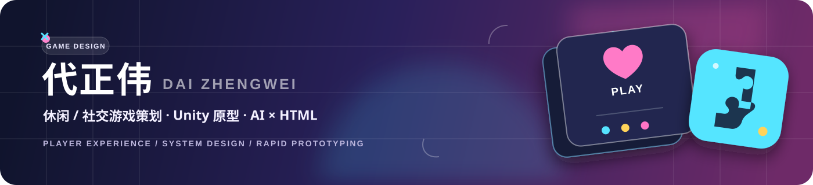
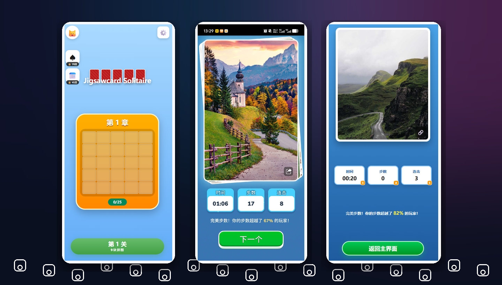
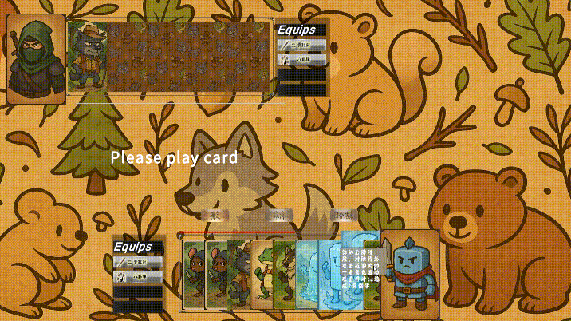
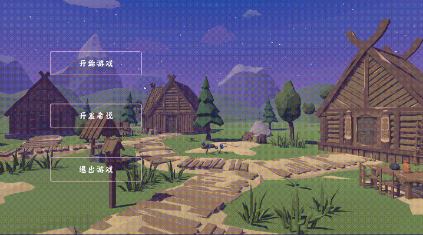

  

  
  
  

  <strong>从玩法观察，到可交互原型。</strong> 
  拆解系统 · 验证体验 · 快速表达设计想法

---

## ⚡ 主打 Demo｜Jigsawcard Solitaire

  

> 基于 **Jigsawcard Solitaire** 的体验观察，使用 AI 辅助完成玩法还原、移动端界面与 HTML 可交互原型，并整理完整开发复盘。

<table>
  <tr>
    <td width="33%" valign="top">
      <strong>🎯 验证目标</strong> 
      用低成本原型快速验证休闲拼图的核心操作与反馈节奏。
    </td>
    <td width="33%" valign="top">
      <strong>🧩 体验流程</strong> 
      串联关卡选择、图片选择、拼图操作与结算反馈。
    </td>
    <td width="33%" valign="top">
      <strong>🤖 AI 工作流</strong> 
      借助 AI 缩短从设计想法到可视 Demo 的实现路径。
    </td>
  </tr>
</table>

  
  
  

---

## 🎮 Player Profile｜我的玩家档案

  

<table>
  <tr>
    <td align="center" width="33%">
      <h3>🎯 设计方向</h3>
      休闲 / 社交手游 
      关注 Coin Master、Dice Dreams 类机制
    </td>
    <td align="center" width="33%">
      <h3>🛠️ 原型能力</h3>
      Unity + C# 
      AI + HTML 可视化玩法 Demo
    </td>
    <td align="center" width="33%">
      <h3>📊 工作方法</h3>
      系统与商业化拆解 
      数据驱动与玩法创新结合
    </td>
  </tr>
</table>

## 🚀 Selected Projects｜项目展台

<table>
  <tr>
    <td width="50%" valign="top">
      
      <h3>🎴 RPG-Card-Game</h3>
      
一个卡牌 RPG 游戏 Demo。

      

        
        
      

      <a href="https://github.com/fantasticdzw/RPG-Card-Game">查看仓库 →</a>
    </td>
    <td width="50%" valign="top">
      
      <h3>🌱 Rebirth</h3>
      
模拟经营之环境保护。

      

        
        
      

      <a href="https://github.com/fantasticdzw/Rebirth">查看仓库 →</a>
    </td>
  </tr>
</table>

---

## 🧰 Toolkit｜技能与工具

| 工作环节 | 常用工具与能力 |
| :--- | :--- |
| **玩法与系统** | 休闲/社交机制 · 系统拆解 · 商业化拆解 |
| **原型与表达** |     |
| **分析与设计** |     |

---

  想一起聊聊玩法、系统，或者看看更多 Demo？ 
  <a href="mailto:1994095830@qq.com"><strong>1994095830@qq.com</strong></a>

